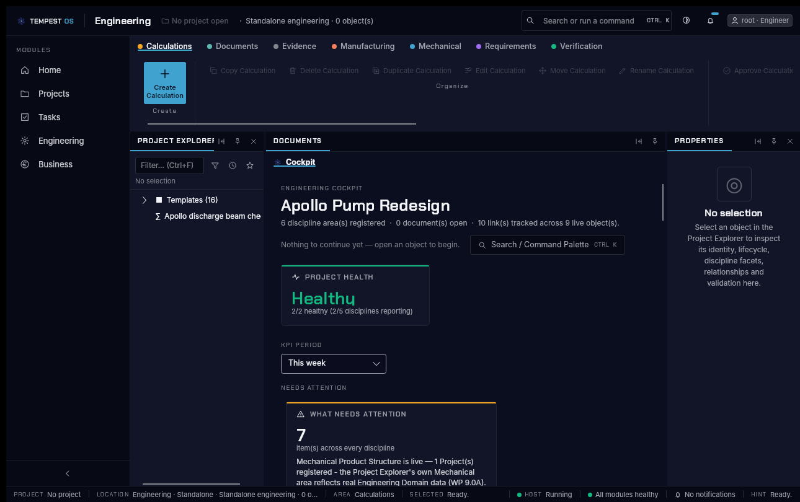
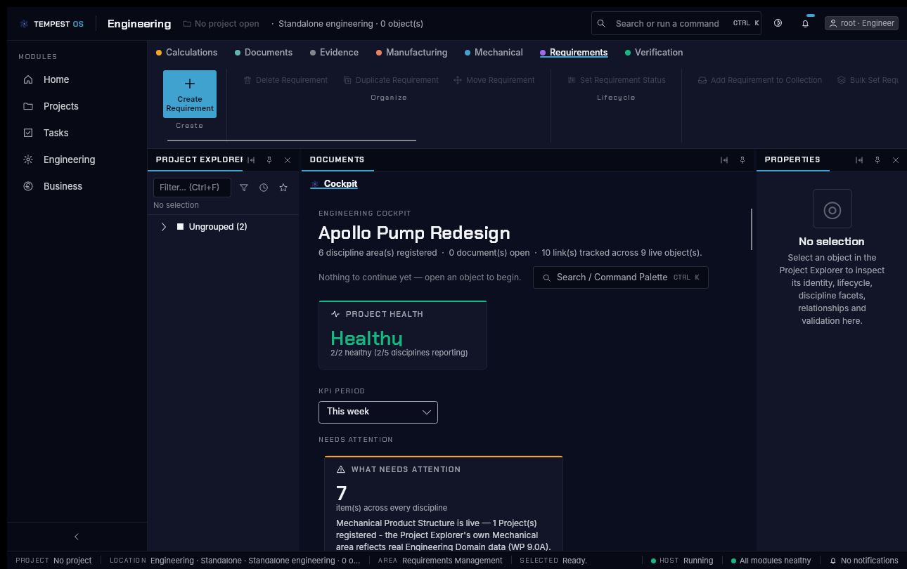
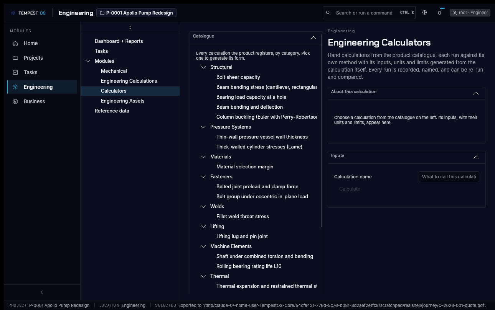

# Engineering navigation — audit and options (v0.24.0 follow-up)

**Product Owner finding (v0.24.0 testing):** the nested sections on the Engineering tab make things hard to find and hard to "work your way out of".

**Status:** audit done. Implementation waits for the Product Owner to choose an option (§4).

Screenshots come from the real shell (`scripts/run-realshell-linux.sh` plus `--mode drive`), 2026-10-18, at a 1290×810 window.

## 1. The composition as it stands

- **Rail** (`GlobalNavigationRail`, `Tempest.Workspace/Shell/NavigationAvailability.cs`) has five entries: Home, Projects, Tasks, Engineering (`ShellArea.EngineeringDepartment`) and Business.
- **The Engineering tree** (`Views/EngineeringAreaView.cs:69-147`):
  - Dashboard + Reports
  - Tasks
  - Modules
    - Mechanical
    - Engineering Calculations
    - Calculators
    - Engineering Assets
  - Reference data
- **The engineering surface** is built once (`MainWindowComposer.Layout.cs:170-180`). It is the ribbon, with the allow-list {Calculations, Documents, Evidence, Manufacturing, Mechanical, Requirements, Verification}, on top of a docking area: Project Explorer, Documents/Cockpit, Properties and Output. `MainWindow.ResolveEngineeringSurfaceHost` (`MainWindow.cs:557`) moves that one surface between two places:
  - the project **Structure** tab;
  - the standalone module host, reached through Modules → Mechanical.
- **Ribbon** (`Views/RibbonView.cs`):
  - There is one tab per command category.
  - Inside each tab, groups are worked out from the end of the command Id (`ClassifyGroup`, :781): Create, then Organize, then Lifecycle, then Actions.
  - Each tab also has a "Recently Used" row.
- **Command palette** opens with Ctrl+K or from the header search box (`CommandPaletteOverlay`). It already lists every registered command.

## 2. How many levels deep each command sits

| Route | Steps to reach a command |
|---|---|
| Standalone: Rail **Engineering** → tree **Modules** → **Mechanical** → ribbon tab → group → button | 5 clicks, through 4 nested levels |
| In a project: Rail **Projects** → project → **Structure** tab → ribbon tab → group → button | 6 clicks, through 5 nested levels |
| Calculators: Rail **Engineering** → **Modules** → **Calculators** → catalogue category → calculation → collapsible *About* and *Inputs* sections | 5 clicks, then 2 collapsibles |
| Palette: Ctrl+K → type → Enter | 1 shortcut. Nothing on the surface tells you it exists, apart from the search box. |

### What each ribbon tab holds

\* opens the Object Editor. † asks for confirmation, then deletes. Every other command runs, prompting for parameters where it needs them. A successful create opens the new object.

| Tab | Create | Organize | Lifecycle | Actions |
|---|---|---|---|---|
| Calculations | create | rename\*, edit\*, move, copy, duplicate, delete† | lock, unlock, request-review, approve, archive | execute, recalculate, rerun, compare-with-previous, complete, set-due-date |
| Documents | create | rename\*, edit\*, move, copy, duplicate, delete† | request-review, approve, release | attach |
| Evidence | create | rename, delete† | — | cite, declare-figure, check, issue, revise, set-subject |
| Manufacturing | create | rename\*, edit\*, move, copy, duplicate, delete† | release, archive | record-inspection-result |
| Mechanical | create | rename\*, edit\*, move, copy, duplicate, delete† | — | set-bom-line, compare-baselines, validate-configuration |
| Requirements | create | move, duplicate, delete† | set-status | 13 buttons: revise\*, set-owner, set-priority, link, create-group, move-group, delete-group†, create-collection, delete-collection†, add-to-collection, bulk-set-status, bulk-set-owner, bulk-set-priority |
| Verification | create | rename\*, edit\*, move, copy, duplicate, delete† | request-review, approve, archive | record-result |

## 3. Findings

1. **No way back out of Mechanical.** Choosing Modules → **Mechanical** swaps the whole Engineering tree for the ribbon surface. Nothing marks where you came from: no breadcrumb, no back button, and no Escape shortcut. The rail also highlights nothing, because `GlobalNavigationRail.RefreshSelection` (:189-196) does not map `ShellArea.Engineering` to the Engineering entry. You only get back by guessing that you should click the rail's Engineering entry again. This is the "work your way out" complaint.

   

2. **The ribbon overflows its own groups.** On Requirements and Calculations, the Organize/Lifecycle/Actions buttons scroll off to the right at 1290 px. The "Actions" bucket gathers everything the suffix rule does not recognise, which is why Requirements carries create, move and delete commands there.

   

3. **The same idea has two names.** The rail calls it "Engineering", the tree calls it "Modules → Mechanical", and the project calls it the "Structure" tab, yet all three lead to the same surface. The header reads "No project open" while the Cockpit shows a project title.

4. **The Calculators page nests three levels in one view.** Tree → catalogue tree → collapsible panels.

   

5. **Most buttons look disabled until you select something.** Selection-aware commands are greyed out, so a tab looks mostly dead until the user picks an object in the Explorer.

## 4. Options — Product Owner to choose

Every option keeps every command Id, handler and enablement rule exactly as it is. Only where commands are shown, and how you move between screens, changes.

### A. One engineering screen: the object tree on the left, a single-row context ribbon on top

- Merge the Engineering tree into the Explorer column as top-level sections: Dashboard, Tasks, Calculators, Engineering Calculations, Assets, Reference data, and then the discipline objects. Retire the separate "Modules → Mechanical" swap.
- The ribbon becomes **one row with no discipline tabs**. It shows Create ▾ (a split button listing every discipline) and then the Organize/Lifecycle/Actions commands for the **selected object's discipline** only. Rarely used commands sit in a "More ▾" overflow menu instead of a scrolling row.
- **For:** one place for everything, at most 2 clicks to any command, and nothing to "get out of".
- **Against:**
  - This is the biggest change, touching the ribbon, the Explorer and `EngineeringAreaView`.
  - When nothing is selected, the row shows only Create.
  - The Desktop ribbon tests that look for discipline tabs (`FeatureCompletionTests`, `LayoutWalkTests`, among others) need to change.

### B. Keep today's layout and add wayfinding

- Add a breadcrumb bar above the surface, for example `Engineering › Mechanical › Requirements`, where every segment can be clicked. Add a **Back** button, with Alt+← as its shortcut.
- Fix the rail highlight for `ShellArea.Engineering`.
- Make the ribbon groups fold into drop-down buttons when they overflow, instead of scrolling off the edge.
- Use the name "Engineering" consistently for the tree node and the project tab.
- **For:** the smallest and lowest-risk change, and current tests stay largely valid.
- **Against:** the nesting is still there. It is just easier to escape from, so the "hard to find" half of the complaint remains.

### C. Command palette first, with a slim ribbon

- Collapse the ribbon to a single strip:
  - a prominent "Find a command or object… Ctrl+K" box;
  - the Create ▾ split button;
  - the five commands most relevant to the current selection.
- The palette, which already lists every command, becomes the main way to find anything, with categories and recently used commands shown when it opens empty.
- Fix the back navigation and rail highlight as in B.
- **For:**
  - quickest for experienced users, with almost no layout to learn;
  - little code, because the palette exists already.
- **Against:**
  - Commands are less visible to new users: you have to know what to type.
  - It moves further from the ribbon look in the design system mock-ups.

### Recommendation

**A, plus B's breadcrumb, Back button and rail fix.**

- A removes the nesting the Product Owner objected to.
- The wayfinding fixes cost little and are worth having in any layout.

If v1.0 timing is tight, ship B now and follow with A.
